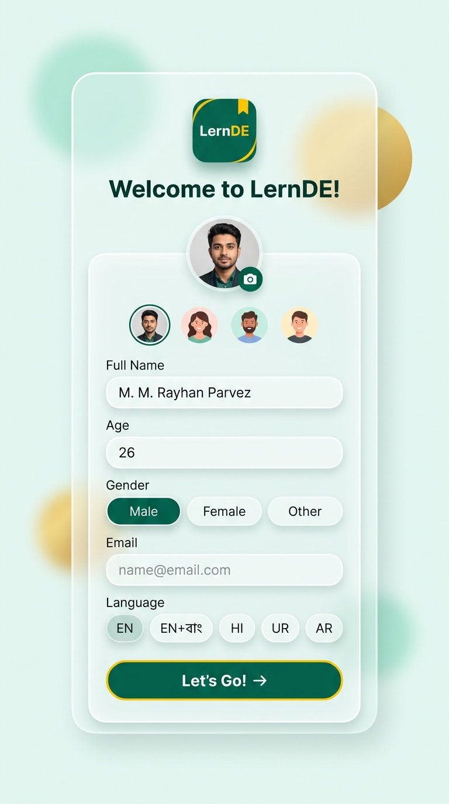
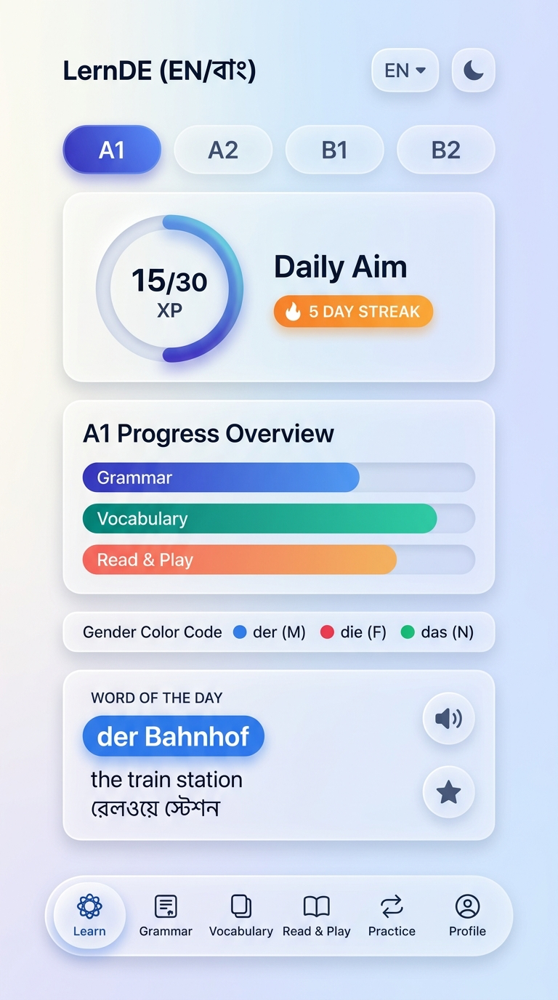
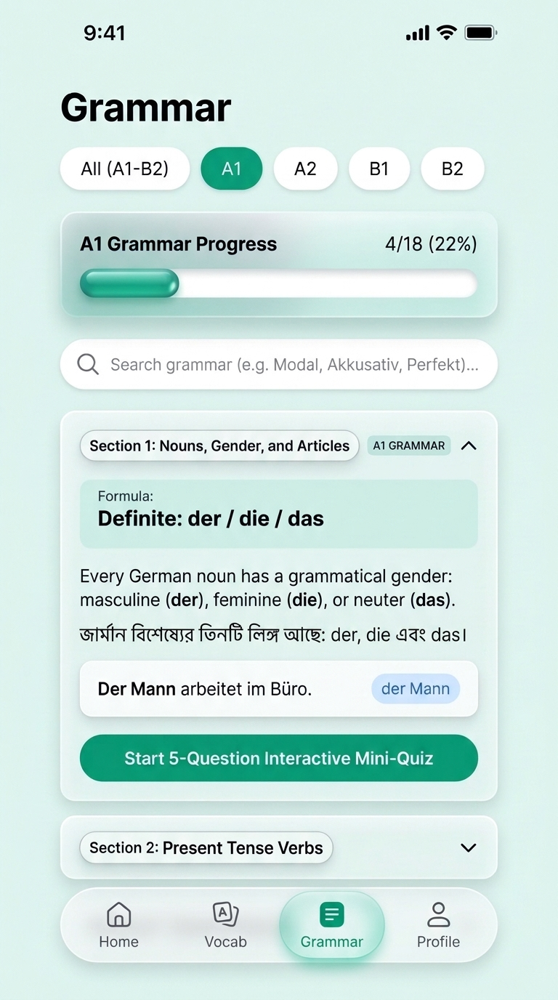
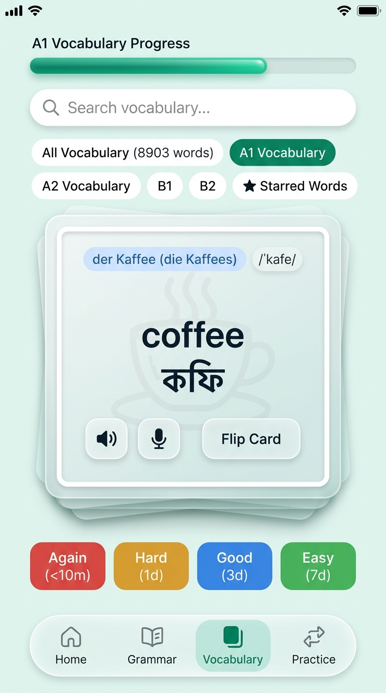
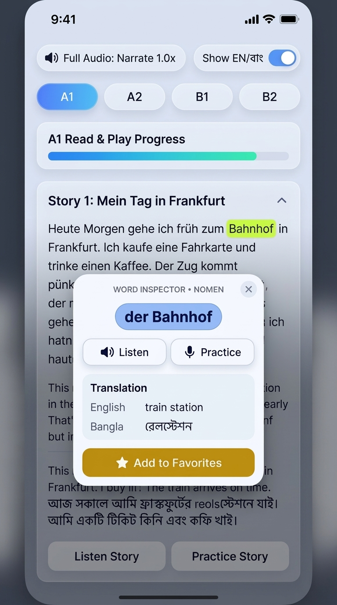
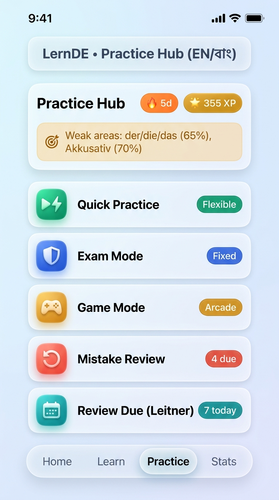
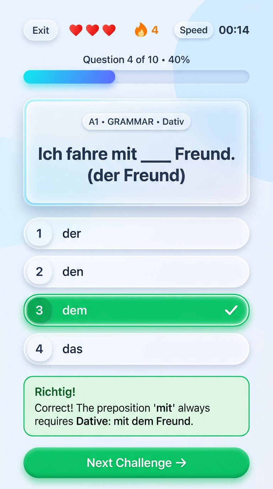
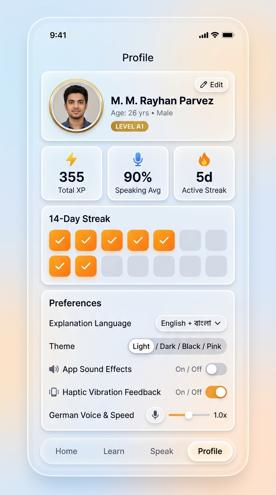

<p align="center">
  
</p>

<h1 align="center">LernDE — Interactive German Learning App (A1–B2)</h1>

<p align="center">
  A cross-platform mobile and web application built with <strong>Expo (React Native + TypeScript + Expo Router)</strong> for mastering German from <strong>A1 to B2</strong> with multi-language support, 3D Material Glass UI, voice pronunciation practice, spaced repetition, and an adaptive Practice Hub.
</p>

---

## Table of Contents

- [Key Features](#key-features)
- [All Screens Showcase](#all-screens-showcase)
- [Practice Engine & Modes](#practice-engine--modes)
- [Project Structure](#project-structure)
- [Getting Started](#getting-started)
- [Testing & Verification](#testing--verification)
- [Building the Android APK](#building-the-android-apk)
- [Author & Copyright](#author--copyright)

---

## Key Features

### 1. Branded Startup Flash Screen & First-Time Onboarding
- **Animated Flash Screen**: Displays the floating `LernDELogo`, progress bar, and developer credit before transitioning into the app.
- **First-Time-Only Setup**: On the very first launch (persisted via `AsyncStorage` until the app is uninstalled/cleared), prompts for your **Profile Picture** (device upload on web or built-in avatar presets), **Full Name**, **Age**, **Gender**, **Email**, and **Preferred Language**, then enters the app with **Let's Go!**.

### 2. Multi-Language Support (English + 5 Native Bridges)
- Global language dropdown in the header and Profile (`en`, `bn`, `both`, `hi`, `ur`, `ar`):
  - **English Only (`EN`)**
  - **Bangla (`EN/বাং`)**
  - **English + Bangla Dual (`EN + বাং`)**
  - **Hindi (`EN/हिन्दी`)**
  - **Urdu (`EN/اردو`)**
  - **Arabic (`EN/العربية`)**
- Always shows English alongside your selected native language across Learn, Grammar, Vocabulary, Read & Play, and Practice.

### 3. 3D Material Glass UI, 4 Themes & Smooth Motion
- **4 Theme Modes**: Light, Emerald Dark, OLED Black, and Pink.
- **3D Material Glass Cards (`MaterialGlassCard`)**: Beveled inner rims, top specular reflection, subtle ambient accent glow, and drop shadows.
- **3D Stacked Vocabulary Flashcards**: Layered deck depth, grounded drop shade, 3D perspective flip (`1200` perspective), and semantic word watermarks (`WordWatermark`).
- **3D Gradient Progress**: Multi-stop SVG gradient **Daily Aim** ring (`CircularProgressRing`) and spring-animated **3D Progress Bars** (`AnimatedProgressBar`).
- **Morphing Bottom Navigation**: Smoothly springs from the full Liquid Glass bottom navbar into a `52×52` floating circular menu button when scrolling down, opening an orientation-aware menu (vertical in portrait, horizontal in landscape).

### 4. Strict German Gender Color Coding
- **Masculine (`der`)**: `#2563EB` (Blue)
- **Feminine (`die`)**: `#DC2626` (Red)
- **Neuter (`das`)**: `#16A34A` (Green)

### 5. Universal Audio & Voice Speaking Practice
- **`<SpeakButton />`**: German TTS (`de-DE`) with `1.0x` normal and `0.7x` slow syllable playback, plus selectable speaker voice & 4 playback speeds in Profile.
- **`<VoicePracticeButton />` & `<VoicePracticeModal />`**: Live German speech recognition (`expo-speech-recognition`) with word-by-word accuracy scoring (`0–100%`) and `+5 XP` bonus at `≥ 80%`.
- **`<FloatingPlaybackPopup />`**: Keeps audio controls accessible when switching tabs during narration.

### 6. Sound & Haptic Feedback Controls
- Independent **App Sound Effects (`On / Off`)** and **Haptic Vibration Feedback (`On / Off`)** toggles in Profile (`soundEffects.ts`).

---

## All Screens Showcase

| Screen | Route / Component | Highlights | Screenshot |
| :--- | :--- | :--- | :--- |
| **Startup & Onboarding** | `StartupOnboardingGate` (`src/components/onboarding/StartupOnboardingGate.tsx`) | Branded splash logo + first-launch profile setup (photo, name, age, gender, language) |  |
| **Learn** | `app/(tabs)/index.tsx` | Daily Aim 3D ring, Streak badge, 3-Section Progress Overview, Daily Reminder & animated **Word of the Day** card, interactive CEFR Lesson Units (Listening, Article Match, Sentence Builder, Speaking) |  |
| **Grammar** | `app/(tabs)/grammar.tsx` | **71 grammar topics** (A1–B2), level filters, search bar, collapsible 3D glass cards with formulas, Bangla parallel notes, examples, and 5-question mini-quizzes with retry queue |  |
| **Vocabulary** | `app/(tabs)/vocabulary.tsx` | **8,903 words** (`2,432` A1, `1,659` A2, `2,375` B1, `2,437` B2), **All Vocabulary** tab, Chapter/Day/Topic/★ Starred filters, 3D Material Glass flip flashcards with word watermarks, SRS ratings (`Again/Hard/Good/Easy`), and Swipe Play game |  |
| **Read & Play** | `app/(tabs)/read.tsx` | **156 reading passages** (A1–B2), full-story narration (`1.0x`/`0.7x`), live spoken-word highlighting, dynamic translation toggle, and tap-any-word **Word Inspector Modal** synced with Favorites |  |
| **Practice Hub** | `app/(tabs)/practice.tsx` (`src/practice/PracticePage.tsx`) | Streak, total XP, Weak Areas summary, and 5 adaptive practice modes with question-by-question answer details & "Open lesson" links |  |
| **Practice Modes** | `src/practice/modes/*` | Quick Practice, Timed Seeded Exams, Game Mode (3 lives + Speed Round), Mistake Review, and 5-Box Leitner Review Due |  |
| **Profile & Settings** | `app/(tabs)/profile.tsx` | Editable user details & avatar, XP/Speaking/Streak stats, 14-day Streak calendar, Language dropdown, 4 Themes, Sound & Vibration toggles, TTS Voice & Speed settings, About the Developer |  |

---

## Practice Engine & Modes

Located in `src/practice/`:

1. **Quick Practice (`QuickPractice.tsx`)**: Pick **5, 8, or 10 questions** filtered by source (`All Mix`, `Words`, `Grammar`, `Story`) and CEFR level (`A1`–`B2` or `All`), with instant feedback and weighted selection toward missed items.
2. **Exam Mode (`ExamMode.tsx`)**: Fixed, reproducible exams (`Exam 1 • A1`, `Exam 2 • A2`, `Exam 3 • B1`) powered by `mulberry32` seeded randomness (`10 Words + 10 Grammar + 1 Story passage`), countdown timer, leave-exam confirmation, **60% pass mark**, and per-section score breakdown.
3. **Game Mode (`GameMode.tsx`)**: Escalating difficulty (`A1 → B2`), **3 lives**, streak XP multiplier, and an optional **18s Speed Round** countdown per question.
4. **Mistake Review (`MistakeReview.tsx`)**: Replays only the questions you missed in random order until mastered.
5. **Review Due (`ReviewDue.tsx`)**: 5-box **Leitner spaced repetition** (`1, 2, 4, 8, 16` day intervals; wrong answers reset to Box 1).

### Supported Question Types
- **Words**: Multiple Choice (`DE → EN`, `EN → DE`), Article Quiz (`der / die / das`), Typing (case/space-insensitive with umlaut & `ae/oe/ue/ss` support), and 5-Pair Matching Game.
- **Grammar**: Fill in the Blank, Word-Bank Sentence Builder, Error Spotting, and Case/Ending Selection.
- **Story**: 5–8 Blank Cloze Test, Comprehension (True/False & Multiple Choice), and Vocabulary in Context.

### Results & Learning Loop (`ResultsScreen.tsx`)
After every practice session, you get:
- Total score, percentage, time, XP earned, section breakdown, and weak areas summary.
- Expandable **Question-by-Question Answer Details** showing your answer, the correct answer, bilingual explanation, and an **Open lesson** shortcut on missed items.

---

## Project Structure

```text
LernDE/
├── app/
│   ├── _layout.tsx                  # Root layout, fonts & StartupOnboardingGate
│   └── (tabs)/
│       ├── _layout.tsx              # Liquid Glass morphing navbar & floating menu
│       ├── index.tsx                # Learn screen + Word of the Day
│       ├── grammar.tsx              # Grammar topics & mini-quizzes
│       ├── vocabulary.tsx           # 3D Material Glass flashcards & Swipe Play
│       ├── read.tsx                 # Story reader & Word Inspector
│       ├── practice.tsx             # Practice tab entry
│       └── profile.tsx              # Profile, preferences & developer info
├── src/
│   ├── components/
│   │   ├── audio/                   # SpeakButton, VoicePracticeButton/Modal, FloatingPlaybackPopup
│   │   ├── common/                  # GlobalHeader, MaterialGlassCard, CircularProgressRing, etc.
│   │   ├── motion/                  # BlastPressable, MotionViews (AnimatedProgressBar, MotionCollapse, etc.)
│   │   ├── onboarding/              # StartupOnboardingGate
│   │   └── vocabulary/              # WordWatermark
│   ├── context/                     # AppContext (AsyncStorage persistence) & WordInspectorContext
│   ├── data/                        # Vocabulary, Grammar, Lessons & Passages (data files gitignored)
│   ├── practice/                    # Practice hub, 5 modes, generators, Leitner, storage & unit tests
│   └── utils/                       # i18n, soundEffects, tts, wordOfTheDay
└── assets/                          # App icons & splash assets
```

---

## Getting Started

```bash
# 1. Install dependencies
npm install

# 2. Start Expo development server
npm run start
```

Other available npm scripts:
- `npm run android` — Launch on Android emulator/device
- `npm run ios` — Launch on iOS simulator
- `npm run web` — Launch in web browser
- `npm run typecheck` — Run TypeScript compiler check (`tsc --noEmit`)
- `npm run sync-csv` — Sync vocabulary CSV files into `src/data/csvVocabularyData.ts`

---

## Testing & Verification

```bash
# TypeScript check
npm run typecheck

# Compile & run Practice Engine unit tests (Node 24+)
npx tsc --module commonjs --target es2022 --esModuleInterop --moduleResolution node --skipLibCheck --outDir /tmp/lernde-test src/practice/__tests__/practiceEngine.test.ts
node --test /tmp/lernde-test/practice/__tests__/practiceEngine.test.js
```

---

## Building the Android APK

Build a standalone release APK locally using Gradle (requires Android SDK & JDK 17):

```bash
./android/gradlew -p android assembleRelease
```

The release APK is generated at `android/app/build/outputs/apk/release/app-release.apk` (or use `eas build -p android --profile preview` via [eas.json](./eas.json)).

---

## About the Developer

**M. M. Rayhan Parvez**  
IT Professional & Software Developer | M.Sc. Informatics (Frankfurt University of Applied Sciences)  
📍 Frankfurt am Main, Germany

Built in Frankfurt to help learners master German from A1 survival basics to B2 professional workplace fluency.

- **Email**: [mmrp.cse@gmail.com](mailto:mmrp.cse@gmail.com)
- **LinkedIn**: [linkedin.com/in/rayhan60611](https://www.linkedin.com/in/rayhan60611/)
- **GitHub**: [github.com/rayhan60611](https://github.com/rayhan60611)

© 2026 M. M. Rayhan Parvez. All rights reserved.
